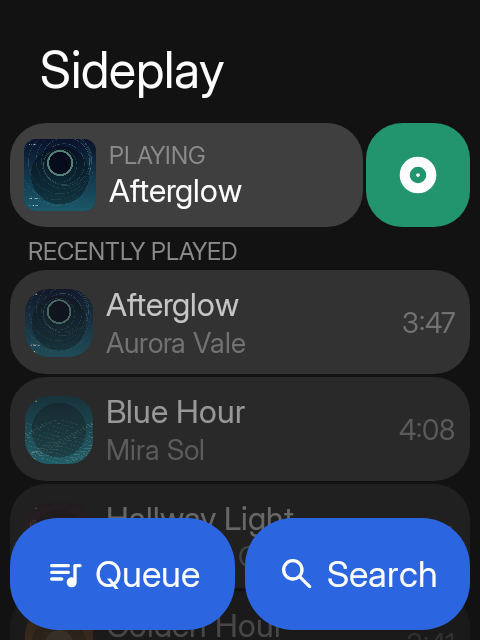
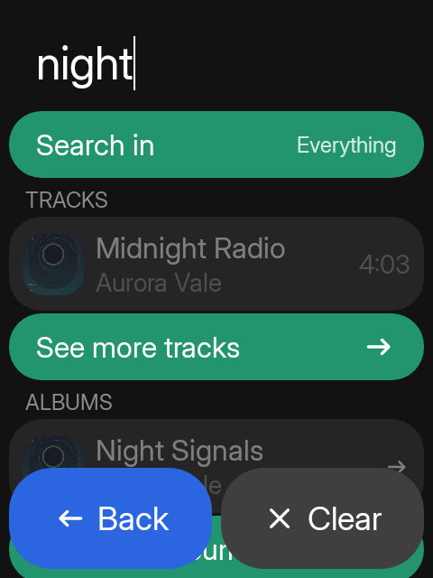
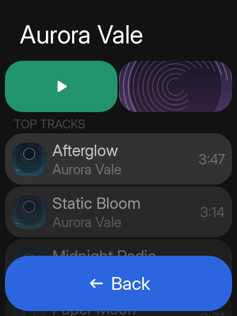
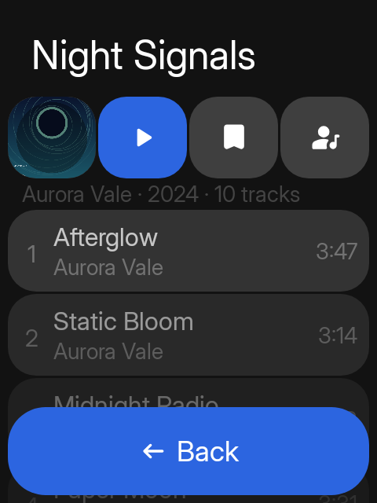
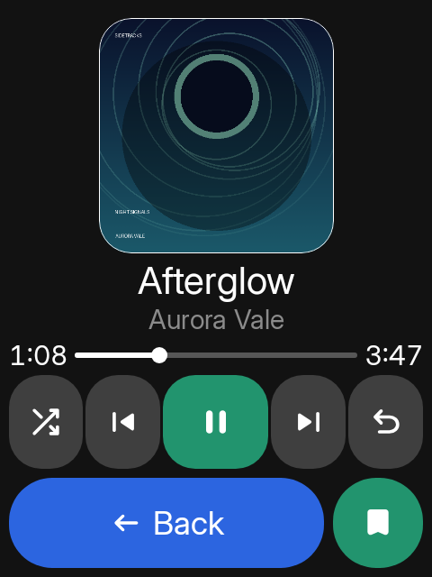
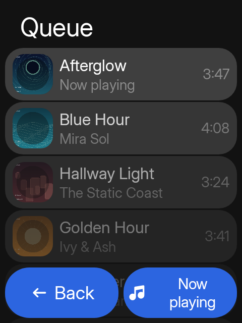
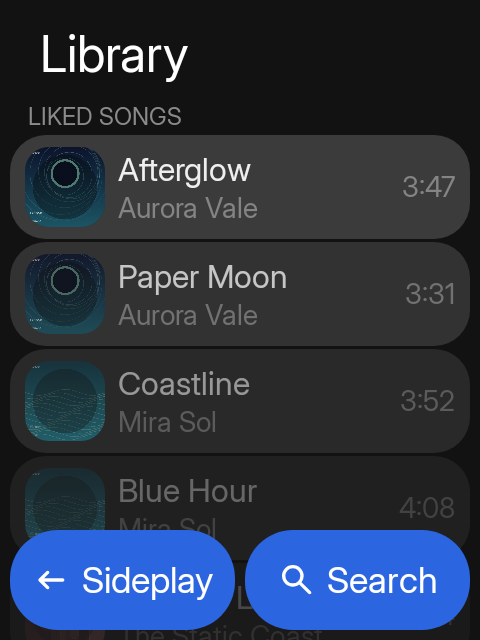
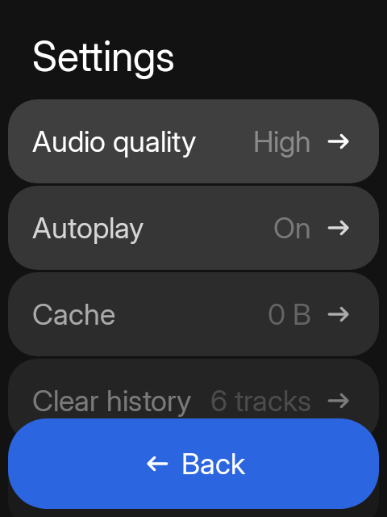
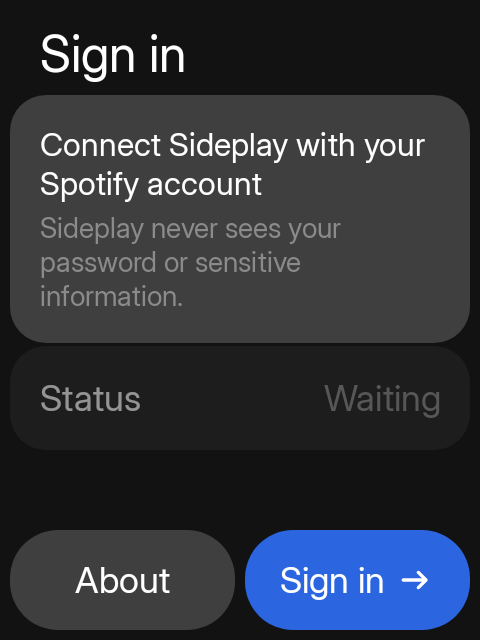

# Sideplay

**Spotify for your Sidephone, built for the keypad.**

Sideplay is a Spotify player for [Sidekit](https://github.com/HarlenPostill/Sidekit), the
minimalistic launcher and app suite for the [Sidephone SP-01](https://www.sidephone.com/).
Sidekit replaces the home screen with a keypad-first launcher and a set of small apps; Sideplay
is one of those apps, and it follows Sidekit's theme, accent, input mode, keypad module, and
custom key mappings when Sidekit is installed.

Sideplay also runs **standalone** on any Android 12+ phone. Without Sidekit it uses its own theme
and keyboard settings, and still works with a touchscreen or a physical keypad.

> Sideplay is an independent project. It is not made by or affiliated with Spotify.

## What you can do

- **Listen to your Spotify library** — playlists, albums, artists, shows, and saved tracks.
- **Search everything** — tracks, artists, albums, playlists, and shows in one place.
- **Control playback** — play, pause, skip, seek, shuffle, repeat, and change volume with the
  phone's own volume keys.
- **Keep a queue** — add tracks, reorder the queue, and see what played before.
- **Save what you like** — like tracks, save albums and shows, follow artists, and add playlists.
- **Use the keypad** — T9, mini QWERTY, Sundial, and game controller are all supported. On the
  mini QWERTY, **T / D / B / J** move up, left, down, and right; **Enter** selects; **Back** goes
  back; the top-right key opens Options.
- **See what is playing** — a full Now Playing screen, lock-screen controls, and a notification
  with artwork and transport buttons.

## Screenshots

These are generated by the app's automatic Roborazzi screenshot tests at the Sidephone canvas
size, not hand-taken photos.

| Home | Search | Artist |
| --- | --- | --- |
|  |  |  |

| Album | Now Playing | Queue |
| --- | --- | --- |
|  |  |  |

| Library | Settings | Sign in |
| --- | --- | --- |
|  |  |  |

## Getting started

1. Install [Sidekit](https://github.com/HarlenPostill/Sidekit/releases/latest) on your Sidephone
   if you want the full launcher and app suite. Sideplay works without it too.
2. Install the Sideplay APK.
3. Open Sideplay and sign in with your Spotify account.
4. Pick something from your library, or press **Search** and start typing on the keypad.
5. Press **OK** / **Enter** to play. Press it again on the track that is already playing to open
   Now Playing.

Lists show a few items at a time. When there is more, a **See more** row appears at the bottom;
press it to load the next page. Nothing extra is downloaded until you ask for it.

## Building it yourself

You need JDK 21 and the Android SDK. For real playback through librespot, you also need the
Android NDK and a Rust toolchain.

```sh
# A normal debug build
./gradlew :app:assembleDebug

# A faster, non-debuggable build for the phone
./gradlew :app:assembleProfile

# Include the native Spotify playback library
./gradlew :app:assembleProfile -PsideplayNative=true
```

Sideplay builds against the published `1.4.1` Sidekit SDK from GitHub Packages. To test
against a local Sidekit checkout instead, set `SIDEKIT_PROJECT_DIR`:

```sh
SIDEKIT_PROJECT_DIR=../Sidekit ./gradlew :app:assembleDebug
```

The `profile` build is signed with the local debug key and is meant for trying Sideplay on a real
device. The `dev` build installs alongside the normal app as
`io.github.manuelrtsch.sideplay.dev`.

More technical notes live in [docs/SIDEPLAY.md](docs/SIDEPLAY.md).

## License

MIT. Sideplay also links librespot; its license and notice ship with the native build.
