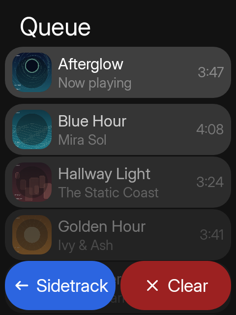
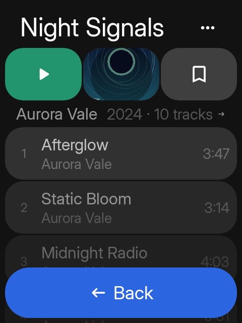
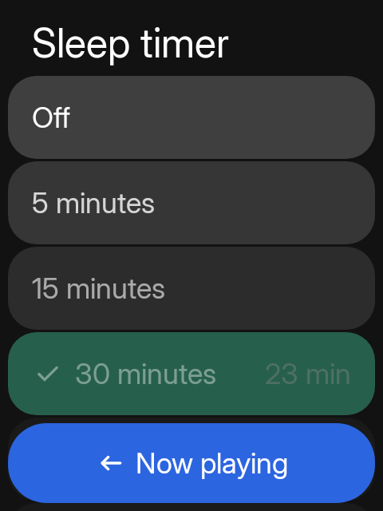

<p align="center">
  
</p>

<h1 align="center">Sidetrack</h1>

<p align="center"><strong>A music player for the Sidephone, built around its keypad.</strong></p>

<p align="center">
  <a href="https://github.com/manuel-rtsch/Sidetrack/releases/latest"></a>
  <a href="LICENSE"></a>
  
  <a href="https://www.sidephone.com/"></a>
</p>

Sidetrack is a capable music player built on the [Sidekit
SDK](https://github.com/HarlenPostill/Sidekit). It is designed for the [Sidephone
SP-01](https://www.sidephone.com/): the whole app is optimized for its small display, and every
action has a keypad path. When Sidekit is installed, Sidetrack follows the launcher's theme,
accent, input mode and key mappings; it also runs on its own on any Android 12+ phone with a
keypad or touchscreen.

> Sidetrack is an independent project. It is not made by or affiliated with any of the music
> services it connects to.

## Designed for the Sidephone

Sidetrack is built around the SP-01 rather than adapted from a touch-first app. The layout is
sized for its small display, and the whole app can be driven from the keypad, with touch as an
equal option.

- **Keypad first** — T9, mini QWERTY, Sundial and game controller input are supported, with
  keypad navigation throughout.
- **Sidekit integration** — when Sidekit is installed, theme, accent, input mode and key
  mappings follow the launcher.
- **Touch-friendly** — swipe actions and on-screen controls cover the same actions.

## Supported services

Sidetrack connects to one service at a time. The choice is remembered until you sign out.
Capabilities vary by service: the interface shows only what the selected service supports, so
podcasts, artist following, gapless playback or playlist creation appear only where they work.

The self-hosted side includes the whole Subsonic family and Plex. **Navidrome**, **Nextcloud
Music** and **Subsonic** itself are listed separately on the welcome screen because that is the
product you run, but they all speak the same Subsonic/OpenSubsonic API and run the same code —
any other Subsonic-compatible server works through the **Subsonic** entry. Picking one keeps its
own credentials, queue and history, so two servers never mix.

| | Spotify | Subsonic family | Jellyfin | Plex |
| --- | --- | --- | --- | --- |
| Sign-in | Browser | Username and password over Subsonic | Username and password | Browser PIN on plex.tv |
| Library | Liked songs, playlists, albums, artists, shows | Starred tracks, playlists, albums, artists | Favourite tracks, playlists, albums, artists | Liked tracks, playlists, albums, artists |
| Search | Tracks, artists, albums, playlists, shows | Tracks, artists, albums, playlists | Tracks, artists, albums, playlists | Tracks, artists, albums, playlists |
| Radio | Song radio from any seed | Similar songs, with a random-song fallback | Instant Mix from any item | — |

| Capability | Spotify | Subsonic family | Jellyfin | Plex |
| --- | :---: | :---: | :---: | :---: |
| Podcasts | ✅ | ❌ | ❌ | ❌ |
| Follow artists | ✅ | ❌ | ✅ | ❌ |
| Create playlists | ❌ | ✅ | ✅ | ❌ |
| Edit playlists | ✅ | ✅ | ✅ | ✅ |
| Loudness normalization | ✅ | ✅ | ❌ | ❌ |
| Gapless playback | ✅ | ❌ | ❌ | ❌ |
| Quality selection | ✅ | ✅ | ✅ | ❌ |

Spotify needs a Premium account for playback. Jellyfin needs a 12.x server with a music library.
Plex needs a claimed Plex Media Server on the same network. On Spotify, podcasts include show
notes, episode numbers, dates, per-episode resume and ±30-second controls. Jellyfin follows
artists through its favourite-artist flag.

## What you can do

- **Listen to your library** — liked tracks, playlists, albums and artists. Spotify adds shows.
- **Search everything** — tracks, artists, albums and playlists in one place, plus shows on
  Spotify.
- **Listen to podcasts properly** (Spotify) — show notes, episode numbers and dates, per-episode
  resume, ±30-second controls, and no song-style shuffle or repeat.
- **Control playback** — play, pause, skip, seek, shuffle, repeat, and volume with the phone's
  own keys. Loudness is normalized where the service supports it, and sequential Spotify tracks
  join without a gap.
- **Keep a queue** — add tracks or whole collections, reorder, and see what played before.
- **Start a song radio** — build a station from whatever is playing.
- **Save what you like** — like tracks, save albums, follow artists on Spotify and Jellyfin.
  Create playlists on Subsonic servers and Jellyfin, and add or remove tracks on every service where
  the account may edit the playlist.
- **See what is playing** — a full Now Playing screen, lock-screen controls, and a notification
  with artwork and transport buttons.

## Screenshots

| Home | Search | Now Playing | Queue |
| --- | --- | --- | --- |
|  |  |  |  |

| Album | Artist | Library | Show |
| --- | --- | --- | --- |
|  |  |  |  |

| Notes | Episode | Welcome | Keyboard |
| --- | --- | --- | --- |
|  |  |  |  |

| History | Sleep timer | Settings | Sign in |
| --- | --- | --- | --- |
|  |  |  |  |

## Getting started

1. Optionally install [Sidekit](https://github.com/HarlenPostill/Sidekit/releases/latest) to use
   Sidetrack alongside the launcher and pick up its theme, accent and key mappings. Sidetrack
   runs without it.
2. Install the Sidetrack APK.
3. Open Sidetrack and choose a service. Spotify and Plex open a browser sign-in; Navidrome,
   Nextcloud Music, Subsonic and Jellyfin ask for a server address, username and password. Any
   Subsonic entry connects to any Subsonic server; Jellyfin needs a 12.x server with a music
   library. Plex finds your claimed server from the account, so there is no address to type.
4. To try the app without an account or a server, choose **Navidrome** and submit the blank
   sign-in form: it signs into the shared demo at
   [demo.navidrome.org](https://demo.navidrome.org) (`demo` / `demo`).
5. Follow the short **Welcome** screen to set up the keyboard and keypad preferences.
6. Pick something from your library or search, and start listening.

## Building from source

You need JDK 21 and the Android SDK. The Subsonic family, Jellyfin and Plex need nothing else. Spotify
playback through librespot also needs the Android NDK and a Rust toolchain.

```sh
./gradlew :app:assembleProfile -PsidetrackNative=true
```

The native bridge is required for Spotify library and search; without it Spotify falls back to
the public Spotify Web API, which currently rate-limits the desktop client ID. Builds without
`-PsidetrackNative=true` still support the Subsonic family, Jellyfin and Plex, but a release build
refuses to package without the bridge — see [docs/releasing.md](docs/releasing.md).

## License

MIT. Sidetrack also links librespot; its license and notice ship with the native build.

Exception: `provider-spotify/src/main/java/io/github/manuelrtsch/sidetrack/auth/` was written with
the GPLv3 Sidespot auth path as a reference and is therefore a derivative of it. That package is
pending a clean-room rewrite or a GPLv3 notice.
