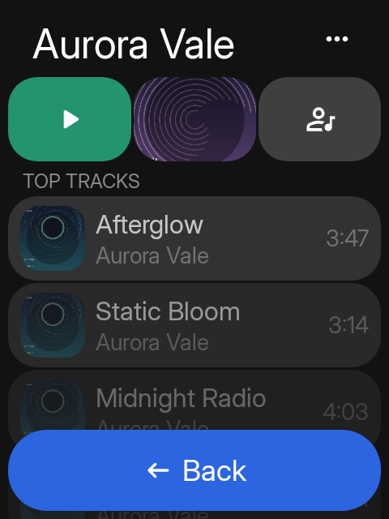
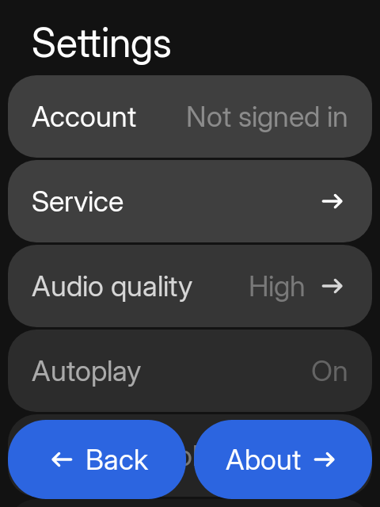
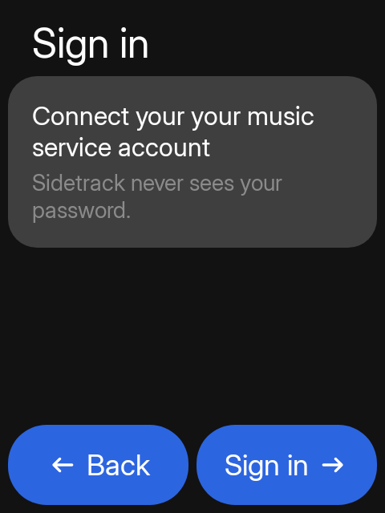

# Sidetrack

**Spotify for your Sidephone, built for the keypad.**

Sidetrack is a Spotify player for [Sidekit](https://github.com/HarlenPostill/Sidekit), the
keypad-first launcher and app suite for the [Sidephone SP-01](https://www.sidephone.com/). It
follows Sidekit's theme, accent, input mode and key mappings when Sidekit is installed, and also
runs standalone on any Android 12+ phone with a touchscreen or a physical keypad.

> Sidetrack is an independent project. It is not made by or affiliated with Spotify.

## What you can do

- **Listen to your library** — playlists, albums, artists, shows and saved tracks.
- **Listen to podcasts properly** — show notes, episode numbers and dates, per-episode resume,
  ±30-second controls, and no song-style shuffle or repeat.
- **Search everything** — tracks, artists, albums, playlists and shows in one place.
- **Control playback** — play, pause, skip, seek, shuffle, repeat, and volume with the phone's
  own keys. Loudness is normalized and sequential tracks join without a gap.
- **Keep a queue** — add tracks or whole collections, reorder, and see what played before.
- **Start a song radio** — build a station from whatever is playing.
- **Save what you like** — like tracks, save albums and shows, follow artists, add playlists.
- **Use the keypad** — T9, mini QWERTY, Sundial and game controller are supported. On mini
  QWERTY, **T / D / B / J** move, **Enter** selects, **Back** goes back, and the top-right key
  opens Options.
- **See what is playing** — a full Now Playing screen, lock-screen controls, and a notification
  with artwork and transport buttons.

## Screenshots

| Home | Search | Artist |
| --- | --- | --- |
|  |  |  |

| Album | Now Playing | Queue |
| --- | --- | --- |
|  |  |  |

| Library | Settings | Sign in |
| --- | --- | --- |
|  |  |  |

## Getting started

1. Install [Sidekit](https://github.com/HarlenPostill/Sidekit/releases/latest) on your Sidephone
   if you want the full launcher and app suite. Sidetrack works without it too.
2. Install the Sidetrack APK.
3. Open Sidetrack and sign in with your Spotify account.
4. On the one-time **Welcome** screen, learn the keypad habits: **Back** returns, **Options**
   opens the page's extra actions, holding **Options** jumps to the action bar, and on touch you
   drag a row left to reveal its menu. Open **Keyboard** to switch modules or enable the
   **Keypad Back key**, then press **Get started**.
5. Pick something from your library, or press **Search** and start typing.
6. Press **OK** / **Enter** to play. The now-playing confirmation in the action bar opens Now
   Playing; pressing **OK** / **Enter** on the current track does the same.

Lists show a few items at a time. When there is more, a **See more** row loads the next page.

## Building from source

You need JDK 21 and the Android SDK. For real playback through librespot, you also need the
Android NDK and a Rust toolchain.

```sh
./gradlew :app:assembleProfile -PsidetrackNative=true
```

The native bridge is required for library and search; without it the app falls back to the
public Spotify Web API, which currently rate-limits the desktop client ID.

## License

MIT. Sidetrack also links librespot; its license and notice ship with the native build.

Exception: `app/src/main/java/io/github/manuelrtsch/sidetrack/auth/` was written with the GPLv3
Sidespot auth path as a reference and is therefore a derivative of it. That package is pending a
clean-room rewrite or a GPLv3 notice.
